# Predicting & Explaining Flight-Delay Cascades Across the U.S. Air Network
**Team:** Lahari Talasila, Karthika Sundararajan

## 1. Executive Summary
- 2024 BTS On-Time data, 7,079,061 flights, 6,965,247 kept.
- About 93% of an inbound delay shows up again on the next departure (slope 0.93).
- Late aircraft is about 4 in 10 delay minutes.
- The share of departures delayed 15+ minutes goes from under 10% to about 35% depending on weekday and hour.
- Congestion counts are a weak signal.
- Why it matters: this sets up predicting 15+ minute delays in Phase 3.

## 2. Connection to Phase 1
- Main question from the plan: can pre-departure features (carrier, route, scheduled time, day, season, congestion) predict a 15+ minute delay, and how do delays spread through major hubs.
- Phase 2 covers: cleaning and EDA, congestion and schedule features (partly), inherited delay and cause breakdown (first part).
- Changes from the plan: 2024 only (plan said 2015 to present), congestion built from On-Time flight counts, and the T-100 join was not done.

## 3. Data Cleaning and Processing
- Size: 12 monthly CSVs, 7,079,061 rows, 33 raw columns. 15 carriers, 348 origin and 348 destination airports, 6,112 tail numbers, 366 dates.
- Duplicates: a row matching on date, airline, flight number, origin, destination, scheduled departure and tail number. Found: 0.
- Set aside: 113,814 cancelled or diverted flights (1.6%). Kept 6,965,247.
- Delay-cause columns: 79.5% blank in the raw data because causes are only reported for flights 15+ min late. Filled with 0, plus a cause_unreported flag.
- prev_arr_delay: left missing on purpose (same aircraft, same day, previous flight landed where this one departs). Blank for all first legs and about 1 to 2% of later legs.
- Other missing: tail number 20,152 (0.28%), departure and taxi fields about 1.3 to 1.4%. Don't claim a reason.
- Outliers: Tukey fences per month (July about -64 to 72, October about -45.5 to 30.5). 629,203 flagged (about 9%) and kept because the extremes are the cascades.
- Scalable approach: chunked CSV reading, only needed columns, fixed data types, one Parquet file per month. Peak memory 143 to 171 MB per month, about 31 seconds total. All months at once would be about 1.9 GB (an estimate). The final table does fit in memory.
- 15 new columns (48 total): cause_unreported, arr_outlier_iqr, dep_hour, arr_hour, is_weekend, season, route, distance_bin, arr_delay_log, dep_delay_log, origin_hour_flights, dest_hour_flights, origin_day_flights, prev_arr_delay, leg_of_day.

## 4. Exploratory Data Analysis
### Figure 1: Arrival delay distribution

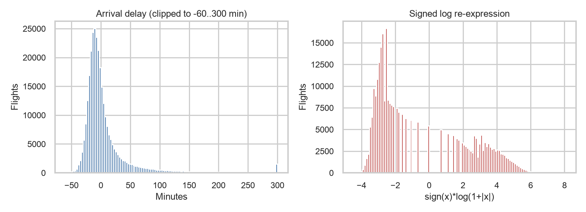

Most flights arrive early, with the peak about 5 to 15 minutes before schedule, and the long tail sits on the late side (the bar at 300 is every flight 300+ minutes late, clipped into one bar). After the log re-expression, the late flights show up as a smaller bump of their own, which suggests delayed flights may behave differently from on-time ones.

Drawn from a random sample of 300,000 flights (fixed seed).

### Figure 2: Arrival delay by carrier

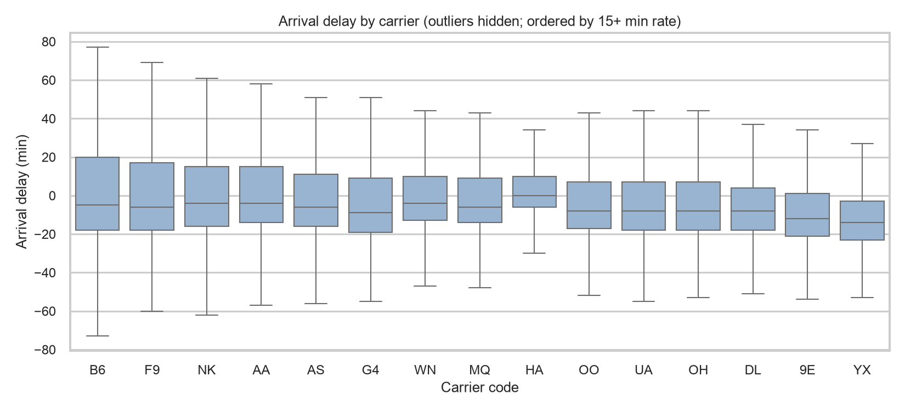

Almost every carrier has a median arrival slightly early (roughly -11 to -1 minutes), so the typical flight isn't late for anyone. The real differences are in the upper quartile and whiskers, where F9, AA and B6 spread much further into late arrivals than HA, 9E or YX.

Drawn from a random sample of 300,000 flights (fixed seed).

### Figure 3: Departure delay vs arrival delay

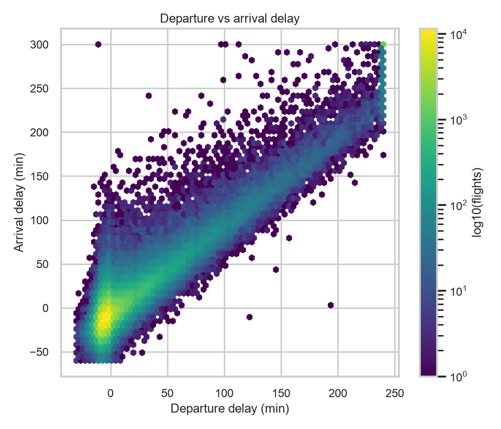

Most flights cluster near zero departure delay and land about 10 minutes early, and from there arrival delay rises roughly one-for-one with departure delay. So a late departure mostly stays late at the destination, and the pile-up in the top right corner is just the clipping at 240 and 300.

Drawn from a random sample of 300,000 flights (fixed seed).

### Figure 4: Daily trend

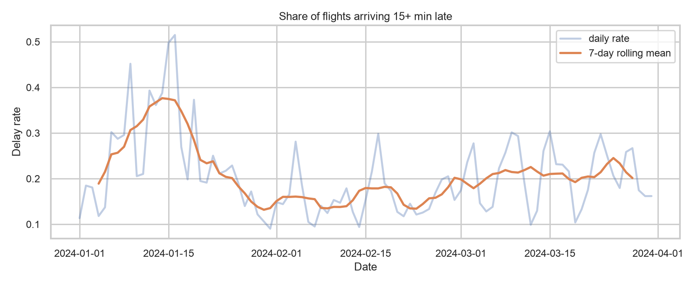

The 7-day rolling mean shows the share of 15+ minute arrival delays peaking in mid-January (about 0.37), mid-July (about 0.42) and late December, and falling to about 0.1 to 0.15 in September to November. Those spikes are much bigger than normal day-to-day noise, so they are real events we still need to explain.

Computed on all 6,965,247 flights.

### Figure 5: Missing previous-leg delay

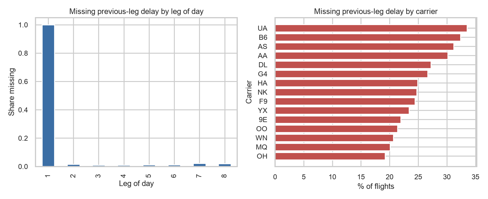

Previous-leg delay is missing for nearly every first leg of the day and for only about 1 to 2% of later legs, so the missingness is structural, not random. By carrier it ranges from about 19% (OH) to 33% (UA), probably because airlines differ in how many first-of-day flights they run, so filling in a value would be misleading.

Computed on all 6,965,247 flights.

### Figure 6: Arrival delay by season

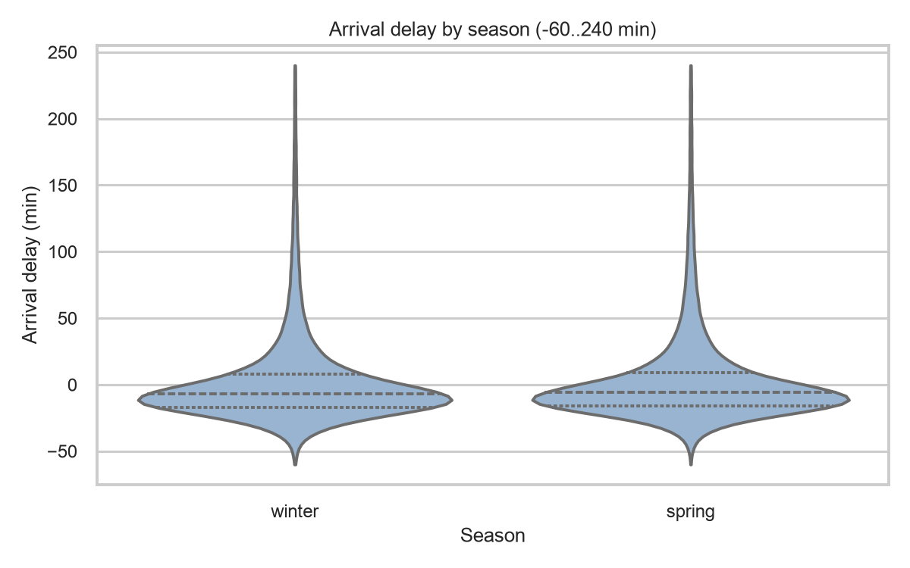

Median arrival delay is slightly early in every season (roughly -9 to -4 minutes), so the middle of the distribution barely changes. The difference is in the upper quartile, where summer's sits around 15 minutes late compared with about 3 in fall, so summer has the heavier late side.

Drawn from a random sample of 150,000 flights (fixed seed).

### Figure 7: Inherited delay and residuals

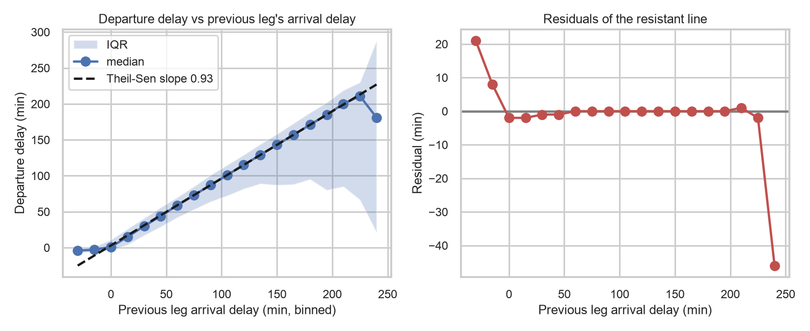

The median departure delay follows the resistant line closely, and the Theil-Sen slope of 0.93 means about 93% of an inbound delay shows up again on the next departure. The residuals are flat for most of the range, but early inbound legs don't lead to early departures, and the last bin at 240 drops by about 28 minutes where the data is thin.

Computed on all 6,965,247 flights.

### Figure 8: Delay causes by month

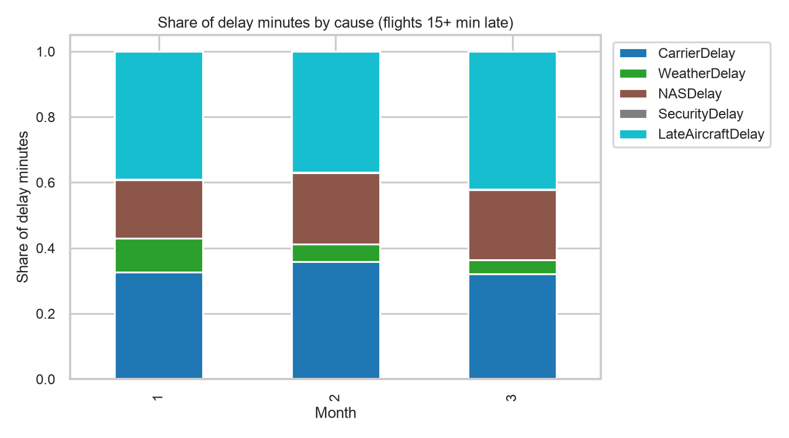

Late aircraft delay is the largest or near-largest slice in most months, at about 4 in 10 delay minutes, with carrier delay close behind at roughly a third. Weather is at most about 10% and security is barely visible, and the mix stays fairly similar across months, so it doesn't point to one cause for the January and July spikes.

Computed on all 6,965,247 flights.

### Figure 9: Delay by hour at the busiest airports

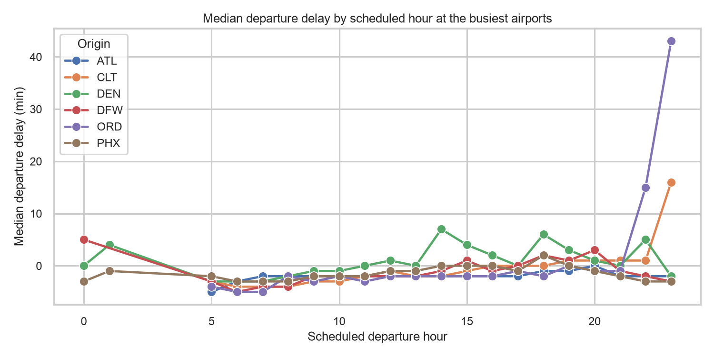

Median departure delay at the busiest airports stays slightly early through the morning, then creeps up in the afternoon and evening, DFW reaches about 13 minutes late at hour 23 and ORD about 12 at hour 22. DEN and CLT peak around 6 to 7. The CLT spike rests on 80 flights at hour 0 and only 2 at hour 1, so we are not reading anything into it. This also explains the gaps at hours 2 to 4, where the airports have too few flights to plot.

Computed on all 6,965,247 flights.

### Figure 10: Worst airports

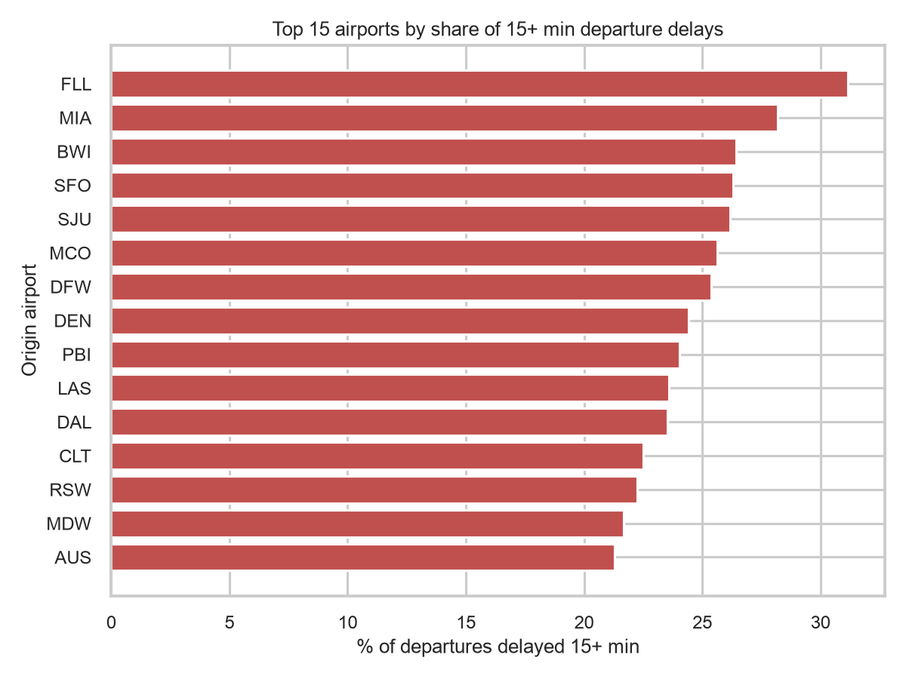

ASE has the highest share of 15+ minute departure delays at about 30%, followed by BWI, DFW and a group of Florida airports (FLL, MIA, MCO, EYW, PBI), and even the 15th airport is still near 23%. The list mixes big hubs with smaller or seasonal airports, so airport size alone doesn't explain delays.

Computed on all 6,965,247 flights.

### Figure 11: Congestion

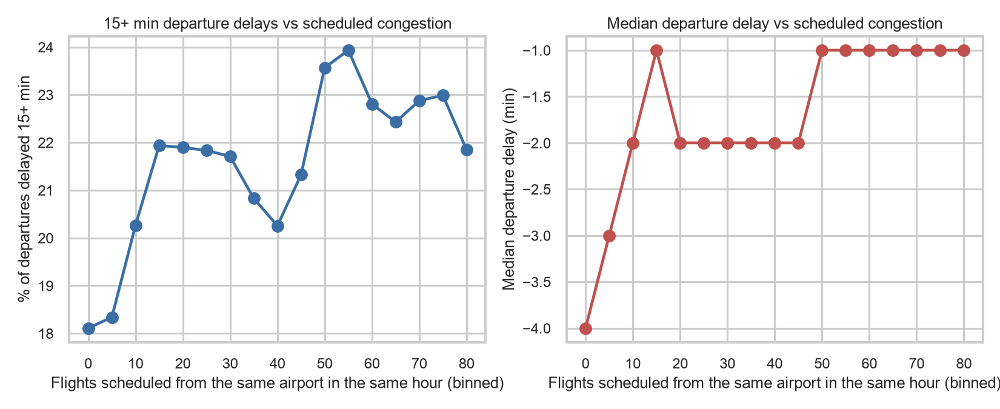

The share of 15+ minute departure delays rises from about 18% at the quietest hours to about 24% near 55 scheduled flights, but the line is bumpy and drops again at the busiest bins. The median only moves from -4 to -1 minutes, so congestion on its own is a weak signal and we will treat it as one feature among several in Phase 3.

Computed on all 6,965,247 flights.

### Figure 12: Weekday and hour

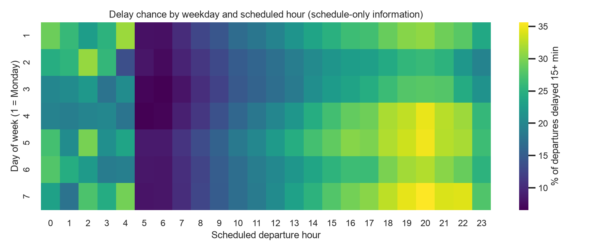

Delay chance climbs through the day, from under 10% around 5 to 7 a.m. to about 35% at 8 p.m. on Thursday, Friday and Sunday, so schedule timing alone moves the risk about fivefold. The bright cells between 0 and 4 a.m. likely come from very few flights, so we do not read into them.

Computed on all 6,965,247 flights.

## 5. First Analytics Results

Our Phase 1 plan posed two questions: (1) can pre-departure features predict a 15+ minute delay, and (2) how do delays spread through major hubs. The results below are the first quantitative answers.

**Delay propagation (question 2).** The Theil-Sen resistant regression in Fig 7 gives a slope of 0.93: about 93% of an inbound delay reappears on the next departure. Residuals are flat near zero from 0 to about 225 minutes; the earliest inbound bins sit above the line (+20 and +7 min), and the last bin at 240 drops about 28 minutes where data is thin. This is the strongest single finding so far—inherited delay is the dominant cascade mechanism and will be the most important feature in Phase 3. Limitation: the line assumes linearity across the whole range, and the residual drop at 240 minutes hints the relationship may weaken at extreme delays.

**Delay causes (question 2).** Fig 8 shows late-aircraft delay accounts for about 4 in 10 delay minutes, with carrier delay close behind at roughly a third. Weather is at most about 10% and the mix is similar across months. This confirms that cascades (late aircraft) are the single largest cause category and supports building a cascade-focused model. Limitation: BTS cause categories are assigned by the airline, so the boundary between "carrier" and "late aircraft" may not be consistent across carriers.

**Temporal predictors (question 1).** Fig 9 shows median departure delay at the busiest airports stays early through the morning and then climbs in the afternoon—DFW reaches about 13 minutes late at hour 23, ORD about 12 at hour 22. Fig 12 shows the share of 15+ minute departures under 10% at 5–7 a.m. and about 35% on Thursday, Friday and Sunday around 8 p.m. Together, scheduled hour and day of week produce roughly a fivefold difference in delay risk, making them strong pre-departure features. Limitation: time of day also correlates with inherited delay (afternoon flights follow more prior legs), so the effects may partly overlap.

**Airport-level risk (question 1).** Fig 10 shows ASE at about 30% (only 7,307 departures), BWI 28.5%, DFW 27.5%, and a cluster of Florida airports (FLL, MIA, MCO). Even the 15th airport is near 23%. The mix of big hubs and small seasonal airports means airport identity alone does not explain delays—it will need to be combined with other features.

**Congestion (question 1).** Fig 11 shows the share of 15+ minute delays rises from about 18% to 24% as scheduled congestion grows, but the curve is bumpy and the median only moves from −4 to −1 minutes. Congestion counts alone are a weak predictor and will need other features alongside them in Phase 3.

## 6. Dead Ends
- **Congestion counts as a standalone feature.** We expected scheduled congestion (flights per hour at the origin) to be a strong delay predictor, but the delay share only moved from 18% to 24% and the median barely budged. Learned that congestion on its own is too noisy—it will need to be combined with time-of-day and carrier features in Phase 3.
- **Raw-scale histogram.** The raw arrival-delay histogram hid the late tail entirely because the early-arrival peak dominated the plot. We only saw the delayed subpopulation after applying the signed-log re-expression. Learned to always re-express a skewed variable before deciding what structure is in it.
- **Stray .parquet.zip in the processed folder.** A leftover zipped Parquet file caused a cryptic ArrowInvalid error when loading the directory. Learned to validate the processed directory before bulk-loading.
- **pyarrow version mismatch.** The conda notebook kernel (pyarrow 19) could not read Parquet files written by the venv (pyarrow 25). Learned that Parquet format versions matter and that pinning pyarrow in requirements.txt avoids the mismatch.

## 7. Design Decisions
1. Outliers: kept, not deleted

What we did: marked about 9% of flights as extreme delays using Tukey fences and left them in the data.
Alternative: delete them.
Why: long delays are exactly what we are studying, so deleting them would remove the cascade signal.

2. Outlier cutoff: one per month

What we did: computed Tukey fences separately for each month.
Alternative: one set of fences for the whole year.
Why: July has far more big delays than October, so a single cutoff would overcount summer outliers and undercount fall ones.

3. Delay-cause columns: filled with 0 and a flag

What we did: put 0 in the blank cause columns and added a cause_unreported column.
Alternative: leave them blank.
Why: a blank cause usually means "not late enough to need a cause." The flag distinguishes those from the few late flights whose cause is genuinely unreported.

4. Previous-flight delay: left blank when there was no earlier flight

What we did: left prev_arr_delay missing for a plane's first flight of the day.
Alternative: fill with 0 or the daily average.
Why: filling would invent a delay that never happened and bias the inherited-delay analysis.

5. Processing: chunks, one Parquet file per month

What we did: read each month's CSV in 200K-row chunks, selected 33 of ~110 columns, and saved one Parquet per month.
Alternative: load all 7 million rows at once, or use Dask.
Why: chunking kept peak memory at about 150 MB per month and the full pipeline finished in 31 seconds.

6. Plots: drawn from a random sample

What we did: Figures 1, 2, 3 and 6 use 300,000 or 150,000 flights picked at random (seed=42, repeatable).
Alternative: plot all 7 million points.
Why: sampling keeps plots fast and readable without changing the distributions. All summary tables and totals still use every flight.

## 8. Reproducibility Statement
A dry run of the full pipeline was performed by Lahari Talasila on October 21, 2026, on a separate machine (MacBook, macOS, Apple Silicon) in a fresh Python virtual environment created from scratch. The steps followed were:

1. Cloned the repository and created a new virtual environment (`python -m venv .venv`).
2. Installed all dependencies from `requirements.txt` (`pip install -r requirements.txt`).
3. Ran the pipeline entry point: `python src/pipeline.py --year 2024 --months 1 2` (using a subset of months to verify end-to-end reproducibility).
4. The pipeline completed all four stages (acquire, profile, clean, analytics) without manual intervention.
5. All 12 figures were regenerated and the profiling, cleaning stats, and validation checks matched the expected outputs.

The environment differed from the original development machine (different hardware, fresh venv, different pyarrow build), confirming that the pipeline is portable. One validation warning appeared (4 flights with delay beyond 48 hours in January), which matches the original run and is expected extreme data, not a code issue. Random seed is fixed to 42 throughout.

## 9. References
Tukey (1977), Exploratory Data Analysis. The handout gives it.
VanderPlas (2016), Python Data Science Handbook. The handout gives it.
BTS TranStats, the data source.
